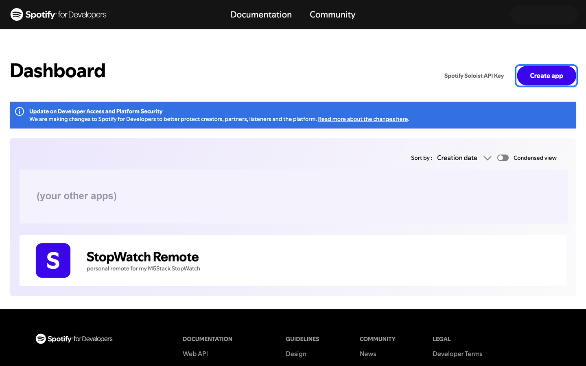
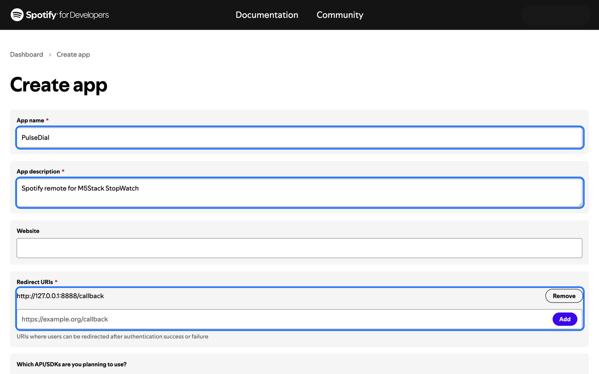
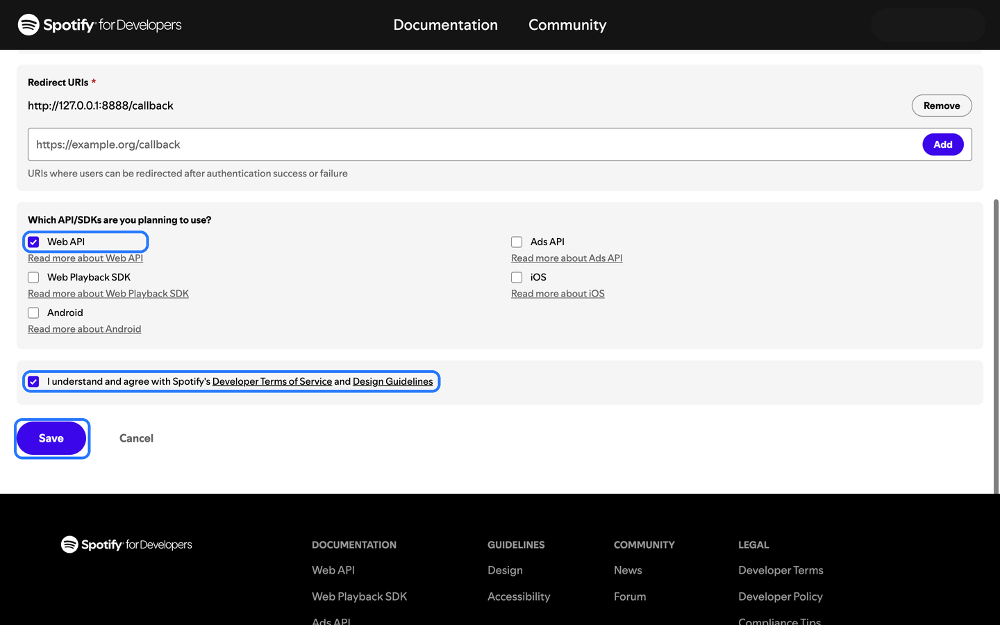
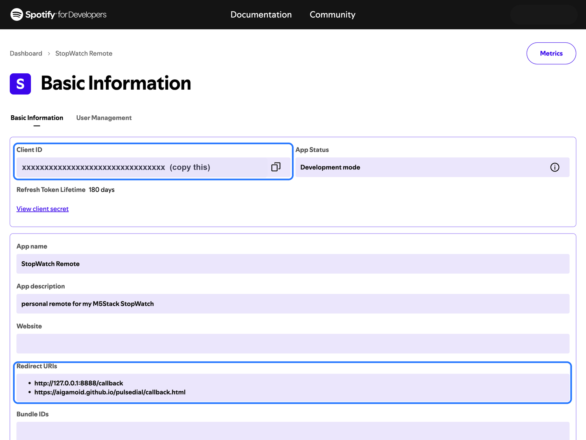

# PulseDial — Spotify remote for M5Stack StopWatch

<p align="center"></p>

PulseDial turns the round AMOLED of the **M5Stack StopWatch** into a remote for the Spotify you are already
playing on your phone, PC or speaker. The album art fills the screen, and a white wave around the edge
shakes on the beat.

**[日本語の説明はこちら ↓](#日本語)**

> PulseDial is an unofficial hobby project. It is not affiliated with, endorsed by, or connected to Spotify
> or M5Stack. Spotify is a trademark of Spotify AB.

<!-- TODO: demo video / GIF -->

## What you need

- M5Stack StopWatch
- **Spotify Premium** (Spotify only lets Premium accounts control playback through its API)
- A PC with Chrome or Edge (to install) and a smartphone (to scan QR codes)
- 2.4 GHz Wi-Fi

PulseDial is a **remote**: the music plays on your phone, PC or speaker, not on the StopWatch.

## Features

- Full-screen album art with a white wave that shakes on the beat
- Tempo from [ReccoBeats](https://reccobeats.com/); if a song is unknown, the microphone listens and finds the beat
- Next shows the next song immediately (it is read ahead of time); going back shows the previous album art without reloading it
- On a song change it shows a remembered pixel version of the album art at once, then the real art, then starts listening for the beat
- Like / unlike, volume, play / pause
- Remembers tempos (2048 songs) and small pixel versions of album art (1024 albums) across power cycles
- Burn-in protection for the AMOLED (the picture slowly drifts, dims when idle, clock after 3 minutes paused)

## Install (3 steps)

### 1. Write the firmware from your browser

1. Connect the StopWatch to your PC with a USB-C cable.
2. Open **https://aigamoid.github.io/pulsedial/** in Chrome or Edge and press **Install PulseDial**.
3. Choose **USB JTAG/serial debug unit** (on a Mac: `cu.usbmodem…`; on Windows: a `COM` port) and press **Connect**.
   If it asks to erase the device, you can leave it unchecked (your Wi-Fi settings and Spotify login are kept).
   Wait until it finishes.

The official apps stay in the menu; PulseDial is added as the first app. To go back to the official
firmware, see [Restore the official firmware](#restore-the-official-firmware).

### 2. Connect to Wi-Fi

1. On the StopWatch, open **PulseDial**.
2. If it has no Wi-Fi yet (or can't connect for 30 s), it shows a QR code. Scan it with your phone to join
   the StopWatch's setup Wi-Fi.
3. Open `192.168.4.1` in the phone's browser and choose your home Wi-Fi (2.4 GHz).

### 3. Log in to Spotify (once)

Each user makes their own small "app" on Spotify's developer site. This is free and takes about 3 minutes.

1. Go to [developer.spotify.com/dashboard](https://developer.spotify.com/dashboard), log in, and press **Create app**.

   

   - App name / description: anything (e.g. `PulseDial`)
   - Redirect URI: `https://aigamoid.github.io/pulsedial/callback.html` (press **Add**)

   

   - APIs used: **Web API**
   - Accept the terms and **Save**.

   

2. Open the app's **Settings** and copy the **Client ID**.

   

3. On the StopWatch, PulseDial shows **Scan to log in to Spotify** with a QR code. Scan it with your phone
   (on the same Wi-Fi as the StopWatch).
4. A page from the StopWatch opens. Paste the **Client ID** and press **Log in with Spotify**.
5. Spotify asks for permission; press **Agree**. The page says **Done!** and the StopWatch switches to the player.

No PC or commands are needed for this step. The StopWatch keeps the key, but Spotify's keys expire after
**180 days**: then PulseDial shows the QR code again, and you log in once more (the Client ID is remembered).

If the page doesn't open: make sure the phone is on the same Wi-Fi as the StopWatch (not on mobile data).
An iPhone may ask to allow access to devices on your local network — allow it. On a Mac browser, the same
permission is in System Settings → Privacy & Security → Local Network.

<details>
<summary>Log in from a PC with a script instead</summary>

Add `http://127.0.0.1:8888/callback` as another Redirect URI of your Spotify app, download this repository
(**Code** → **Download ZIP**) and run `python3 tools/spotify_login.py` (Windows: `py tools\spotify_login.py`,
Python 3.9+). Enter the Client ID, and the IP and PIN shown on the StopWatch.
</details>

## Controls

| | |
|---|---|
| Button A | Play / pause |
| Button B | Next song (press twice: previous song) |
| Hold B | Like / unlike |
| Tap the screen | Show details for 7 s (device, BPM, time) |
| Tap ♥ | Like / unlike |
| Swipe left / right | Next / previous |
| Swipe up / down | Volume (if the playing device allows it) |
| Hold A + B | Back to the menu |
| Hold A for 10 s | Log out of Spotify (to log in with another account or Client ID) |

## Privacy and data

- **Spotify**: the StopWatch talks directly to Spotify's Web API. The login key (refresh token) is stored only
  on the StopWatch (NVS). `spotify_login.py` never prints or saves it on the PC.
- **ReccoBeats**: to get the tempo, the StopWatch sends the **Spotify track ID** (nothing else) to
  `api.reccobeats.com`, a free public API.
- **Microphone**: used only on the StopWatch to find the beat. Nothing is recorded or sent.
- **Login**: while PulseDial shows the login QR code, the StopWatch serves a small page on port 8080 of your
  home network (it needs the 4-digit PIN in the QR code) and stops it after login. After you agree, Spotify sends
  your browser to `aigamoid.github.io/pulsedial/callback.html`, which only hands the one-time login code to the
  StopWatch on your network. The StopWatch exchanges it for the key itself; the code is useless without a secret
  (PKCE) that never leaves the StopWatch. The local page uses plain HTTP, so log in on a network you trust.
- The StopWatch remembers tempos and small pixel pictures per song/album in its flash (`/spiflash/spotify`).
  Song names are not stored.

## Limitations

- Spotify's login key lasts 180 days, so you log in again about twice a year.
- Spotify Premium is required, and Spotify limits each developer app to 5 users (that's why everyone makes
  their own). Spotify changed its developer rules in 2026 and may change them again; PulseDial may stop
  working until it is updated.
- Only for M5Stack StopWatch (round 466×466 AMOLED, ESP32-S3).
- The first album art after opening the app takes a few seconds (the first secure connection is slow).
- Text and the progress bar can be hard to read on very white album art.

## Restore the official firmware

Follow M5Stack's guide: [StopWatch – Restore factory firmware](https://docs.m5stack.com/en/guide/restore_factory/stopwatch)
(uses M5Burner).

## Build from source

PulseDial is built on [m5stack/M5StopWatch-UserDemo](https://github.com/m5stack/M5StopWatch-UserDemo)
(the first commit of this repository is an unmodified copy; the second adds PulseDial).

1. Install [ESP-IDF v5.5](https://docs.espressif.com/projects/esp-idf/en/v5.5.4/esp32s3/get-started/index.html)
   (tested with v5.5.4). The path to this repository must not contain spaces.
2. Fetch the components (this also applies `patches/`, including a small M5GFX fix PulseDial needs):

   ```bash
   python3 ./fetch_repos.py
   ```

3. Build and flash:

   ```bash
   idf.py build
   idf.py -p <PORT> flash
   ```

PlatformIO is not tested with PulseDial. `tools/make_release.sh <version>` copies a build into `docs/` for the
web installer (GitHub Pages).

### Where things are

| Path | What |
|---|---|
| `main/apps/app_pulsedial/` | The app: `SpotifyClient` (Web API, album art, tempo), `GlassUi` (screen), `SpotifyViz` (beat from the mic), `TrackMemory` (what it remembers) |
| `main/hal/hal_audio.cpp` | `audioReadMic` added for the visualizer |
| `patches/M5GFX.patch` | Keeps M5GFX's DMA buffer from shrinking (prevents a crash) |
| `tools/spotify_login.py` | One-time login on a PC |
| `tools/make_icon.py` | Draws the launcher icon |
| `docs/` | Web installer page, and `callback.html` (the Spotify login hands the code back to the StopWatch) |

Source comments in `app_pulsedial` are mostly in Japanese.

## License

MIT (see [LICENSE](LICENSE)). Based on M5StopWatch-UserDemo by M5Stack (MIT).
Includes the QR Code generator library by Project Nayuki (MIT).
The upstream README is kept as [README.upstream.md](README.upstream.md).

---

## 日本語

**PulseDial** は、**M5Stack StopWatch** の丸い有機 EL を、スマホや PC、スピーカーで流している Spotify の
**リモコン**にするアプリです。ジャケットが画面いっぱいに出て、ふちの白い波形が拍に合わせて震えます。
音は StopWatch からは出ません。

> 個人の非公式プロジェクトです。Spotify・M5Stack とは関係ありません。Spotify は Spotify AB の商標です。

### 必要なもの

- M5Stack StopWatch
- **Spotify Premium**（再生の操作は Premium でないとできません）
- Chrome か Edge が使える PC（書き込み用）と、スマホ（QR を読む用）
- 2.4 GHz の Wi-Fi

### 入れ方（3 ステップ）

1. **ブラウザで書き込む**：StopWatch を USB-C で PC につなぎ、Chrome か Edge で
   **https://aigamoid.github.io/pulsedial/** を開いて **Install PulseDial** を押します。
   ポートは **USB JTAG/serial debug unit**（Mac は `cu.usbmodem…`、Windows は `COM` の番号）を選びます。
   「Erase」を聞かれたらチェックなしで大丈夫です（Wi-Fi の設定と Spotify のログインが残ります）。
   公式のアプリはメニューに残り、PulseDial がいちばん前に入ります。
2. **Wi-Fi につなぐ**：StopWatch で PulseDial を開きます。Wi-Fi が未設定なら QR コードが出るので、スマホで読み取り、
   `192.168.4.1` を開いて家の Wi-Fi（2.4 GHz）を選びます。
3. **Spotify にログインする（最初の 1 回だけ）**
   1. [developer.spotify.com/dashboard](https://developer.spotify.com/dashboard) で **Create app** を押します。
      名前と説明は何でもよく、Redirect URI に `https://aigamoid.github.io/pulsedial/callback.html` を入れて **Add**、
      APIs used は **Web API** を選び、規約に同意して **Save** します。
      （画面の例は上の英語の手順にあります）
   2. アプリの **Settings** で **Client ID** をコピーします。
   3. StopWatch に「**Scan to log in to Spotify**」と QR コードが出るので、スマホで読み取ります
      （スマホは StopWatch と同じ Wi-Fi につないでおきます）。
   4. StopWatch のページが開くので、**Client ID** を貼り付けて **Spotify にログイン** を押します。
   5. Spotify の画面で **同意する** を押すと、ページに「完了しました」と出て、StopWatch がプレイヤーに切り替わります。

この手順に PC やコマンドは要りません。Spotify の鍵は **180 日**で切れます。切れると PulseDial に QR が
また出るので、もう一度ログインしてください（Client ID は覚えています）。

ページが開かないとき：スマホが StopWatch と同じ Wi-Fi につながっているか（モバイル通信になっていないか）を
確かめてください。iPhone は「ローカルネットワーク上のデバイスへのアクセス」を聞いてくることがあるので、許可します。
PC のスクリプト（`tools/spotify_login.py`）でもログインできます（上の英語の説明の「Log in from a PC」）。

### 操作

| | |
|---|---|
| A ボタン | 再生 / 一時停止 |
| B ボタン | 次の曲（2 回押すと前の曲） |
| B を長押し | お気に入り（♥）の付け外し |
| 画面をタップ | 詳細を 7 秒出す（機器・BPM・時間） |
| ♥ をタップ | お気に入りの付け外し |
| 左右にスワイプ | 次 / 前の曲 |
| 上下にスワイプ | 音量（再生中の機器が対応していれば） |
| A と B を同時に長押し | メニューに戻る |
| A を 10 秒長押し | Spotify からログアウト（別のアカウントや Client ID でログインし直すとき） |

### データの扱い

- Spotify のログインの鍵は StopWatch の中（NVS）にだけ保存します。PC には残しません。
- テンポを調べるため、**Spotify の曲 ID だけ**を無料の公開 API [ReccoBeats](https://reccobeats.com/) に送ります。
- マイクは拍を見つけるためだけに使い、録音も送信もしません。
- ログインの QR が出ている間だけ、家の LAN で port 8080 に小さなページを開きます（QR に入っている 4 桁の PIN が必要）。
  Spotify で同意すると、ブラウザが `aigamoid.github.io/pulsedial/callback.html` に戻り、このページが 1 回きりの
  ログインのコードを家の中の StopWatch に渡すだけです。鍵への交換は StopWatch が自分で行い、コードは StopWatch の中の
  合言葉（PKCE）がないと使えません。家の中のページは暗号なしの HTTP なので、信頼できるネットワークでログインしてください。

### 元に戻すには

M5Stack 公式の手順で工場出荷時のファームウェアに戻せます：
[StopWatch の工場出荷時ファームウェアの復元](https://docs.m5stack.com/ja/guide/stopwatch/restore_factory)（M5Burner を使います）。

### 注意

- Spotify は 2026 年に開発者向けのルールを変えました（Premium が必要・1 つのアプリにつき 5 人まで）。
  また変わると、PulseDial が更新されるまで動かなくなることがあります。
- 対応しているのは M5Stack StopWatch だけです。
