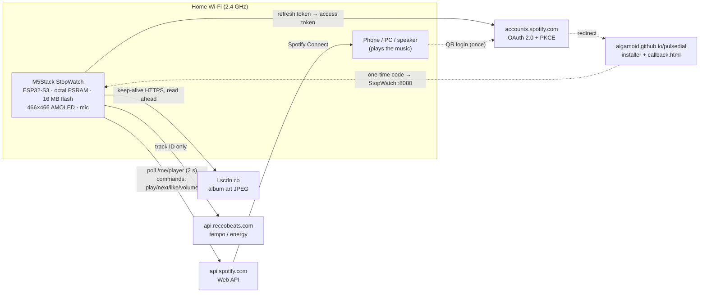
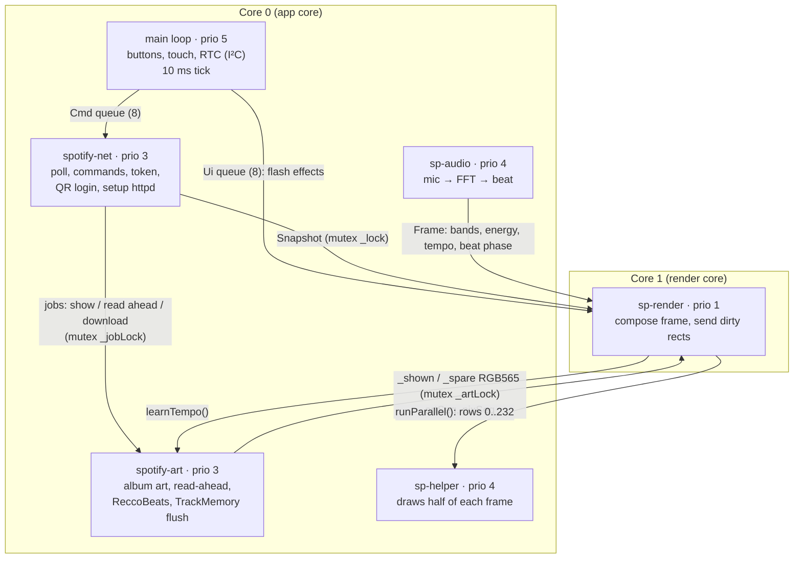
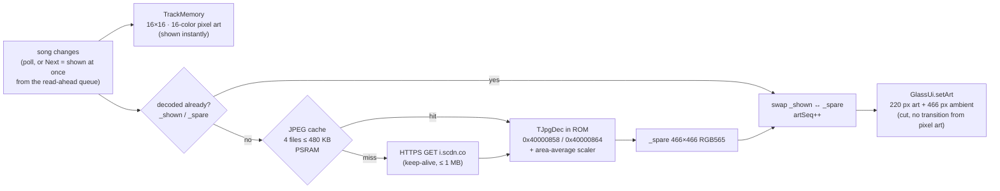
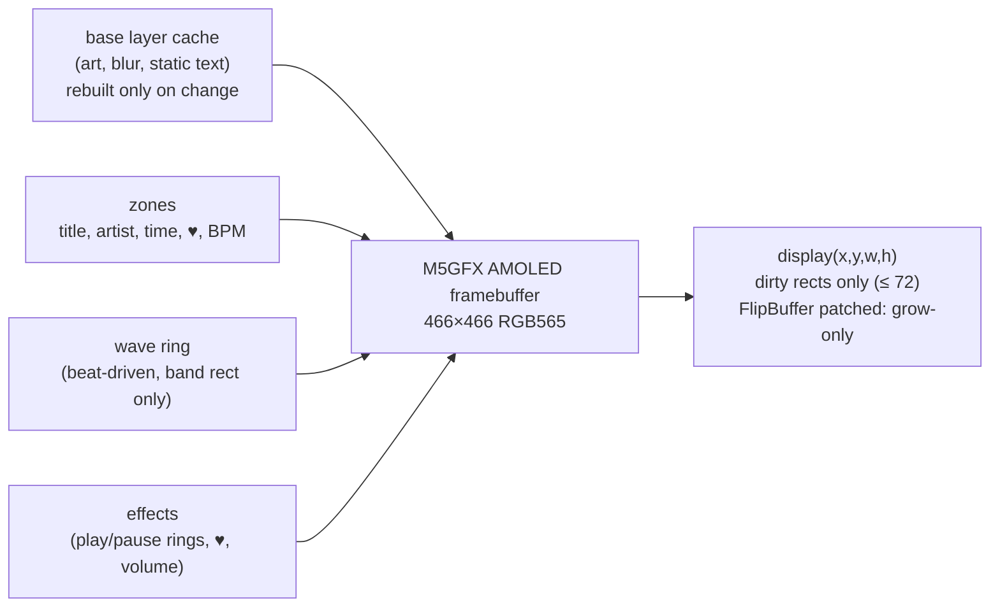
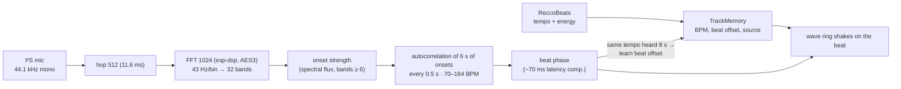
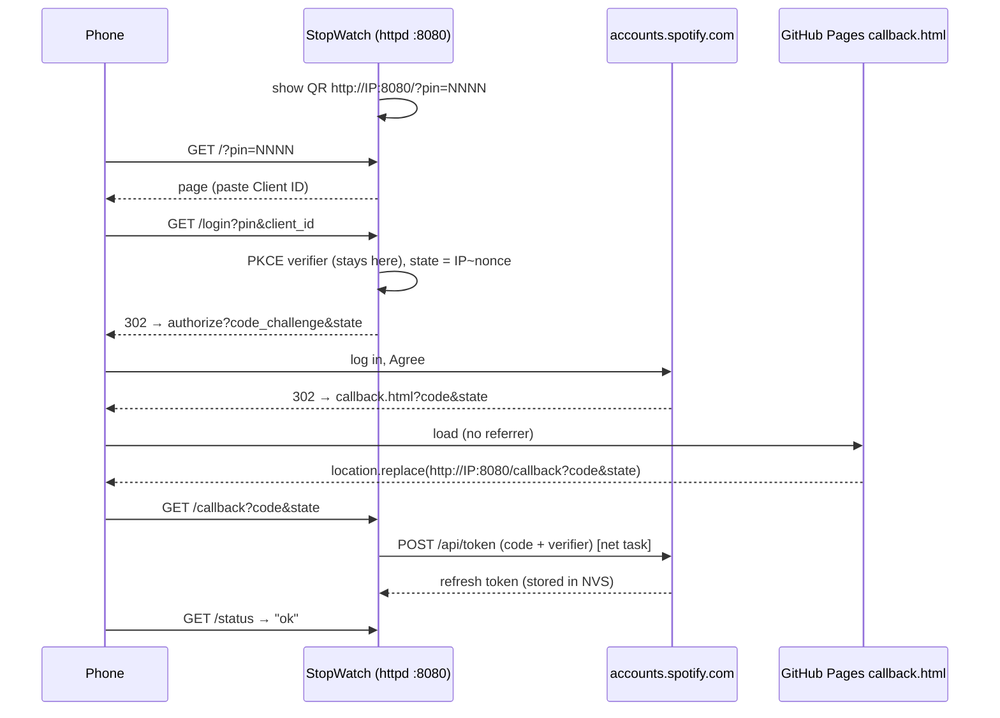

# PulseDial architecture

How a 466×466 round AMOLED on an ESP32-S3 shows Spotify at ~28 fps, with a beat-synced wave, on two cores.
All numbers below are from the source (`main/apps/app_pulsedial/`).

日本語の要約は [各図の下](#日本語の要約) にあります。

---

## 1. System overview

The StopWatch never plays audio. It is a Spotify Connect **remote**: it reads the player state and sends
commands, and the music keeps playing on the phone, PC or speaker.

## 2. Tasks and cores

- Network and JPEG work never block drawing: the render task only copies a `Snapshot` and swaps pointers.
- While a JPEG is decoded the render task stops using the helper core, so decoding gets the CPU (3 s → 0.5 s).
- The mic stays off until the real album art is shown (avoids competing with the decode and the TLS handshake).

## 3. Album art: from a song change to pixels

- **Read ahead**: `/me/player/queue` gives the next two songs. The next one is downloaded *and decoded* into
  `_spare`; the one after is only downloaded. Going back shows the previous art from `_spare` too.
- TJpgDec is called by address because a same-named LVGL copy would be linked instead.
- Progressive JPEGs are rejected (ROM TJpgDec can't do them); the real size is read from the SOF marker
  because Spotify's "640 px" images are sometimes 500 px.

## 4. Drawing a frame

- Frame rate: 30 fps after input, 20 fps playing untouched, 15 fps paused, 10 fps clock, 4 fps Wi-Fi setup.
- Typical cost while playing: draw ≈ 23 ms (split over 2 cores), send ≈ 6 ms, ~180 rows/frame.
- Burn-in care: the whole picture drifts on a 14 px circle every 1.5 s; dimmer when idle; clock after 3 min paused.
- `patches/M5GFX.patch`: sending many rects of different widths made M5GFX free and re-allocate its DMA buffer
  every time, fragmenting internal RAM until an allocation failed. The patch makes it grow-only.

## 5. Finding the beat

Priority of sources: remembered value → ReccoBeats → microphone. With a known BPM, beats are placed from the
playback position (`(position − offset) mod 60000/BPM`), and the mic only refines the offset. With earphones
(nothing heard for 30 s) the mic is switched off.

## 6. QR login (no PC needed)

- The code that passes through the browser is useless without the PKCE verifier, which never leaves the StopWatch.
- `callback.html` only forwards to private IPv4 addresses (10/8, 172.16/12, 192.168/16).
- The token exchange runs on the network task (8 KB stack); the httpd task's stack is too small for TLS.
- `CONFIG_HTTPD_MAX_URI_LEN=1536`: the login code doesn't fit the default 512-byte URI.
- Refresh tokens last 180 days; `invalid_grant` sends PulseDial back to the QR screen.

## 7. What it remembers (flash)

| File (`/spiflash/spotify/`) | Slots | Slot | Key |
|---|---|---|---|
| `tempo.bin` | 2048 songs | 24 B: BPM×10, beat offset, source, energy, stamp, FNV-1a32 sum | FNV-1a64(track ID) |
| `pix.bin` | 1024 albums | 176 B: 16-color RGB565 palette + 16×16 4-bit indices, stamp, sum | FNV-1a64(image ID) |

Fixed-size slots, rewritten one at a time (or the whole file if more than 32 changed); least-recently-used slot
is replaced when full; a slot with a wrong checksum (power cut while writing) is dropped on load. Song names
are not stored. NVS (`spotify` namespace) holds only the Client ID and the refresh token.

---

## 日本語の要約

1. **全体**：StopWatch は音を鳴らさない「リモコン」。Spotify の Web API を 2 秒ごとに見にいき、操作を送る。
   ジャケットは i.scdn.co、テンポは ReccoBeats（曲 ID だけ送る）から取る。
2. **タスクとコア**：コア 0 に通信・ジャケット・マイク・描画の手伝い、コア 1 に描画。描画は状態の写し（Snapshot）を
   受け取るだけなので、通信や JPEG の展開で止まらない。
3. **ジャケット**：曲が変わったら、まず覚えていたドット絵 → 展開ずみなら入れ替えるだけ → なければ JPEG のキャッシュか
   ネットから取り、チップの ROM にある TJpgDec で 466px に縮めながら展開する。次の曲は先に展開しておく。
4. **描画**：変わったところだけ画面バッファに描き、その四角だけ送る。2 つのコアで半分ずつ描く。
5. **拍**：覚えた値 → ReccoBeats → マイク（FFT 1024、立ち上がりを 6 秒ためて 0.5 秒ごとに自己相関、70〜184 BPM）の順。拍の位置は再生位置から計算し、
   マイクで 8 秒そろったら覚える。
6. **QR ログイン**：PKCE の合言葉は本体の中だけ。ブラウザを通るコードだけでは鍵に換えられない。
7. **記憶**：BPM 2048 曲・ドット絵 1024 アルバムを、決まった大きさの枠でフラッシュに。曲名は持たない。
